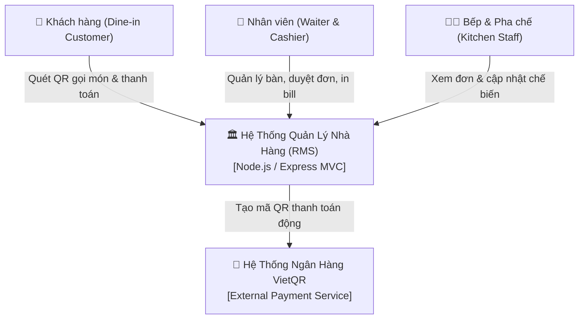
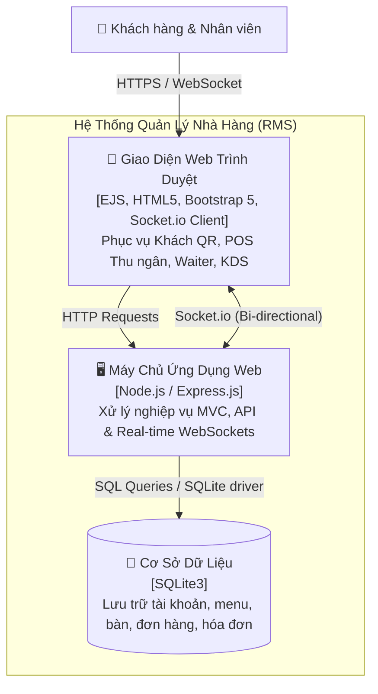
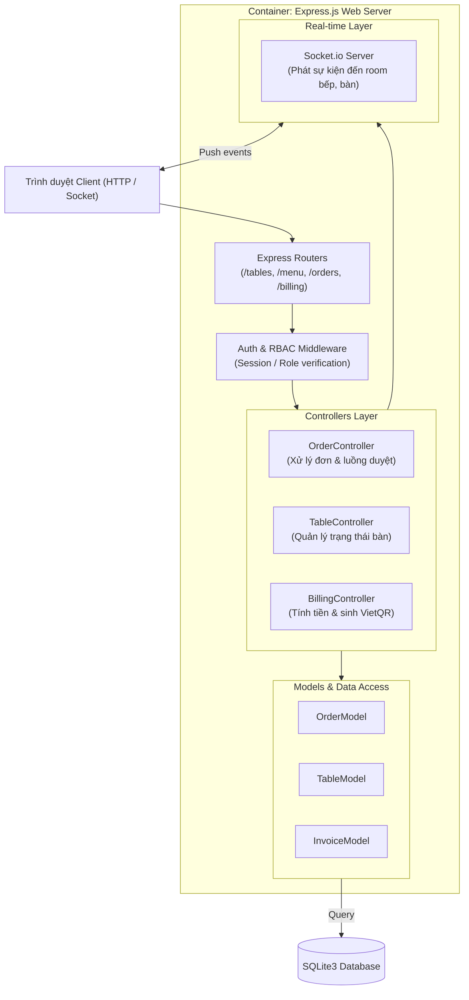

# Antigravity C4 Component Architect

This skill guides the agent to act as a Principal Software Architect, performing automated bottom-up code analysis and producing standardized **C4 Model** diagrams (Context, Container, Component, Code) for architectural documentation, reports, and technical specifications.

---

## 1. The C4 Model Hierarchy

When documenting software systems, structure architecture diagrams according to the 4 progressive levels of zoom:

1. **Level 1: System Context Diagram**
   - **Scope:** Highest level abstraction.
   - **Focus:** The system under design, surrounded by its users (actors) and external third-party systems (e.g., VietQR API, Payment Gateways, Email/SMS services).
   - **Audience:** Technical and non-technical stakeholders, product managers.

2. **Level 2: Container Diagram**
   - **Scope:** High-level technical architecture.
   - **Focus:** Deployable units and executables (Web Application, Single-Page App, API Server, Mobile App, Database, File Storage).
   - **Audience:** Developers, operations, system architects.

3. **Level 3: Component Diagram**
   - **Scope:** Inside a single container (e.g., inside the Express.js Backend Server).
   - **Focus:** Major internal structural modules (Controllers, Services, Repositories, Real-time Socket Handlers, Authentication Middleware).
   - **Audience:** Software engineers implementing features.

4. **Level 4: Code / Class Diagram**
   - **Scope:** Detailed design of complex classes, data structures, or algorithms.

---

## 2. Generating C4 Diagrams with Mermaid

### A. System Context Diagram (Level 1)

### B. Container Diagram (Level 2)

### C. Component Diagram (Level 3 - Express MVC Container)

---

## 3. Automated Code Scanning Protocol

When instructed to document architecture from an existing codebase:
1. **Scan `package.json`**: Identify dependencies, framework, database connectors, and engines.
2. **Inspect routing directory (`routes/` or `controllers/`)**: Map out all functional endpoints.
3. **Inspect data schema (`models/` or SQL migrations)**: Map database tables and relationships.
4. **Identify communication protocols**: Check for WebSockets, HTTP REST, background workers.
5. **Synthesize**: Generate corresponding C4 Context, Container, and Component diagrams with concise annotations.
