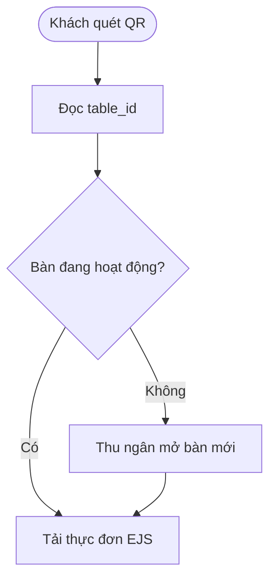
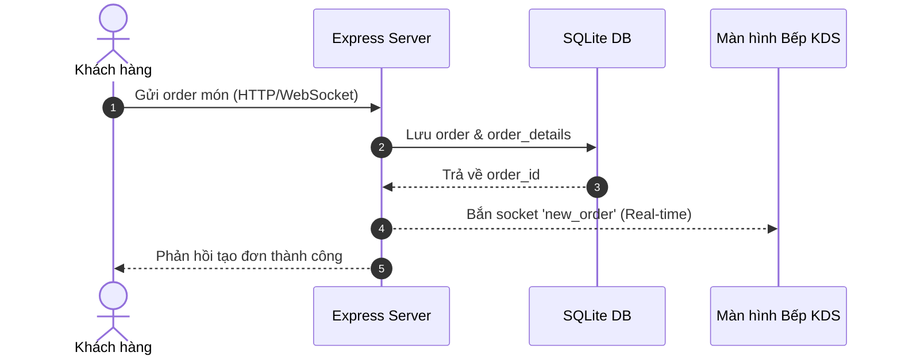
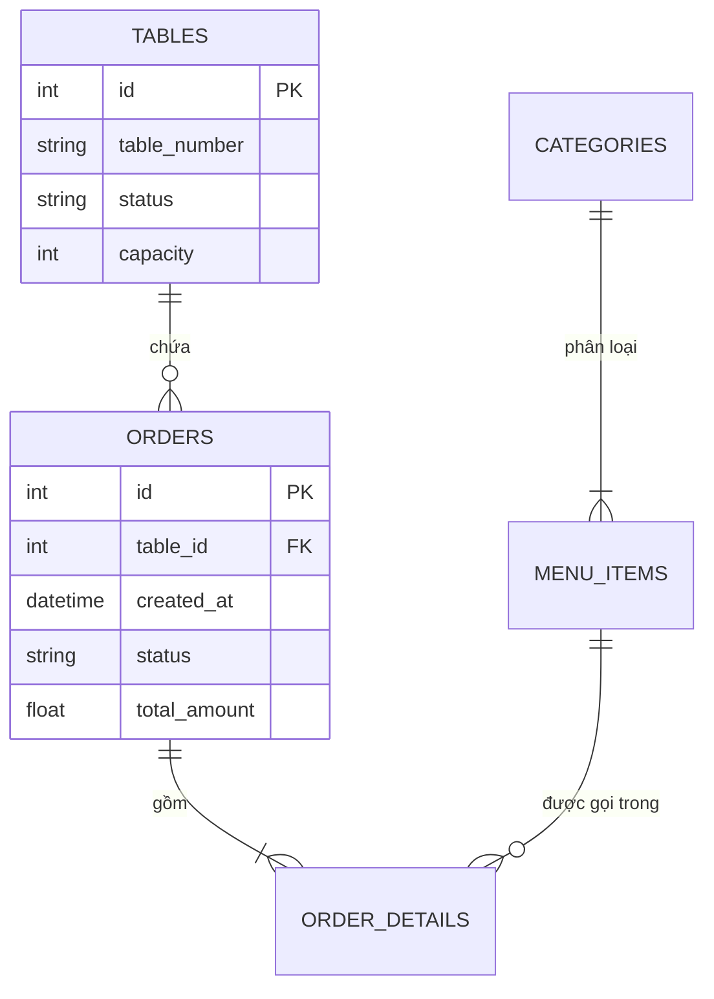
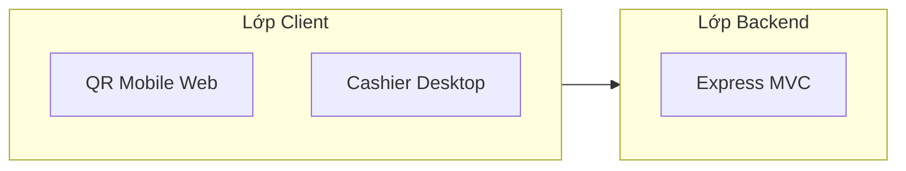

# Antigravity Mermaid Expert Guide

This skill trains the agent to produce robust, visually aesthetic, and zero-error Mermaid diagrams across all supported diagram types in Markdown and Antigravity artifacts.

---

## 1. Syntax Reliability & Error Prevention Rules

1. **Always Quote Node Labels with Special Characters:**
   - Any label containing parentheses `()`, brackets `[]`, braces `{}`, quotes, colons `:`, slashes `/`, or ampersands `&` **MUST** be enclosed in double quotes.
   - **Correct:** `id["Tầng 1 (10 bàn)"]`
   - **Incorrect:** `id[Tầng 1 (10 bàn)]` (will crash Mermaid parser).

2. **Never Use Unescaped HTML in Labels:**
   - Avoid ` `, `<b>`, `<i>` inside node texts in chat artifacts unless strictly validated. Use newline strings inside quotes if supported or split into sub-nodes.

3. **Supported Diagram Types in Antigravity Artifacts:**
   - Flowcharts / Graphs: `flowchart TD` / `flowchart LR` / `graph TD` / `graph LR`
   - Sequence Diagrams: `sequenceDiagram`
   - State Diagrams: `stateDiagram-v2` or `stateDiagram`
   - Class Diagrams: `classDiagram`
   - Entity-Relationship Diagrams: `erDiagram`
   - XY Charts: `xychart-beta`
   - *Note:* For roadmaps or project schedules, use directed flowcharts or Markdown tables instead of unsupported diagram types.

---

## 2. Best Practices by Diagram Type

### A. Flowcharts (`flowchart TD` / `flowchart LR`)
- Use meaningful alphanumeric node IDs (`startNode`, `checkAuth`, `saveOrder`).
- Clearly distinguish decisions with `{...}`, processes with `[...]`, and external systems with `[(...)]`.
- Example:

### B. Sequence Diagrams (`sequenceDiagram`)
- Always declare participants / actors explicitly with `actor` or `participant`.
- Use `autonumber` for clear step-by-step reading in reports.
- Use `alt / else / end`, `opt / end`, and `loop / end` for control flows.
- Example:

### C. Entity-Relationship Diagrams (`erDiagram`)
- Use standard Crow's Foot notation:
  - Exactly one: `||`
  - Zero or one: `|o`
  - Zero or more: `}o`
  - One or more: `}|`
- Explicitly define fields, types, and constraints (`PK`, `FK`).
- Example:

---

## 3. Styling & Subgraphs

- Group related components into subgraphs with clear identifiers:

- Keep node labels concise, meaningful, and professional.
